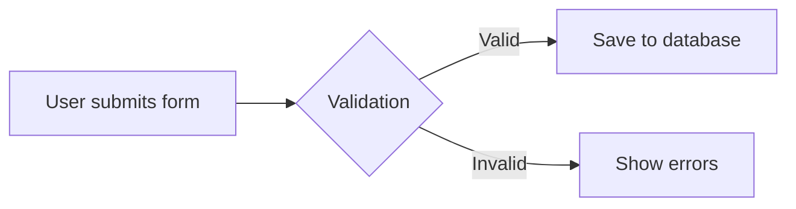
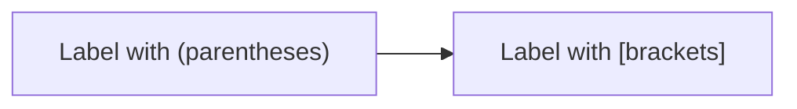

## Best Practices

### Prefer Horizontal (Landscape) Orientations

**IMPORTANT**: Use horizontal layouts (LR, RL) whenever possible. Horizontal diagrams are much easier to view and navigate in the UI.

- **Flowcharts**: Use `graph LR` (left-right) instead of `graph TD` (top-down)
- **State Diagrams**: Add `direction LR` after the header
- **Sequence Diagrams**: Naturally horizontal, no changes needed
- **Class Diagrams**: For wide hierarchies, consider splitting into multiple horizontal diagrams
- **ER Diagrams**: Naturally horizontal, no changes needed

**Only use vertical layouts (TD, BT) when**:
- The diagram is inherently hierarchical (org charts, tree structures)
- The vertical layout is significantly clearer than horizontal
- The diagram has very few nodes (3-4 max)

### Keep Diagrams Focused

One concept per diagram. If a diagram gets complex, split it into multiple diagrams.

### Use Descriptive Labels



### Choose the Right Direction

**Horizontal (preferred)**:
- **LR (left-right)**: DEFAULT - Use for flows, pipelines, state machines, processes, and most diagrams
- **RL (right-left)**: Reverse flows (when semantically meaningful)

**Vertical (use sparingly)**:
- **TD (top-down)**: Only for hierarchies, inheritance, org charts where vertical structure is essential
- **BT (bottom-top)**: Only for dependencies pointing upward

### Validate Complex Diagrams

Use the `mermaid_validate` tool to check syntax before outputting complex diagrams:

```
mermaid_validate({ code: "graph TD\n  A --> B" })
```

## Troubleshooting

### Common Errors

1. **Missing direction**: Always include direction in flowcharts (`graph TD`, not just `graph`)
2. **Unbalanced brackets**: Ensure all `[`, `(`, `{` are properly closed
3. **Special characters in labels**: Use quotes for labels with special characters
4. **Invalid arrow syntax**: Check the arrow type table above

### Escaping Special Characters

For labels with special characters, wrap in quotes:


